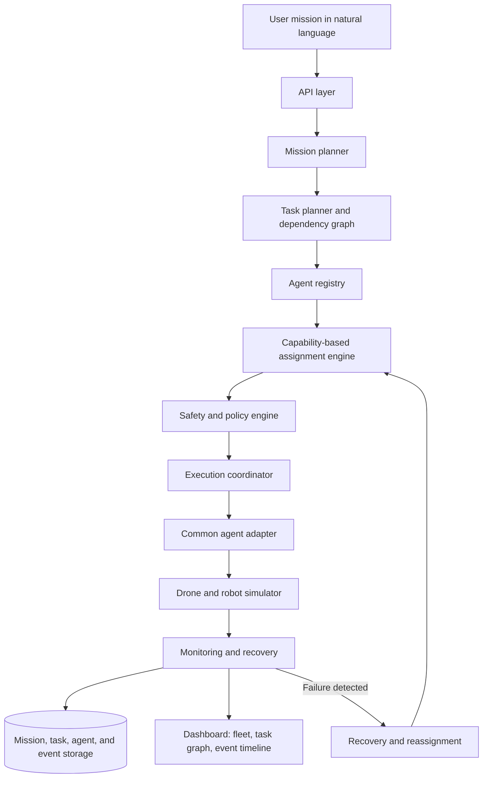

# SwarmOS — Multi-Agent AI Orchestration Platform

> **One Mission. Any Machine. One Control Plane.**

SwarmOS is a vendor-neutral orchestration platform concept for coordinating heterogeneous autonomous agents through a shared mission, task, capability, and status layer. For the hackathon MVP, it models a warehouse workflow with a simulated inspection drone and mobile robots—without requiring physical robot integration.

A user describes a mission in natural language. SwarmOS turns it into validated structured tasks, checks dependencies and safety policies, assigns eligible agents, tracks execution, and records events. If an agent fails, the recovery workflow attempts to reassign its work to another eligible agent.

> **Project status:** Hackathon MVP / active development. Features described below are target capabilities from the SRS; only mark a feature as implemented once it is available and tested in the repository.

---

## Contents

- [Why SwarmOS?](#why-swarmos)
- [MVP Scenario](#mvp-scenario)
- [Core Capabilities](#core-capabilities)
- [Architecture](#architecture)
- [Mission Lifecycle](#mission-lifecycle)
- [Technology Stack](#technology-stack)
- [Getting Started](#getting-started)
- [API Overview](#api-overview)
- [Safety and Reliability](#safety-and-reliability)
- [MVP Acceptance Criteria](#mvp-acceptance-criteria)
- [Scope and Limitations](#scope-and-limitations)
- [Roadmap](#roadmap)

## Why SwarmOS?

Robots, drones, and autonomous software agents often expose different interfaces, capabilities, and status information. Coordinating them across one workflow can be difficult.

SwarmOS aims to provide a common orchestration layer that:

- Represents missions and work as structured tasks.
- Matches tasks only with capable and available agents.
- Enforces deterministic policy checks before assignment and dispatch.
- Tracks task state, agent state, and execution events.
- Recovers from simulated agent failures when an eligible replacement exists.

## MVP Scenario

The canonical warehouse mission is:

> “Inspect Zone A and transport eligible packages to Dispatch without entering restricted areas.”

The simulated environment contains four zones:

| Zone | Purpose |
|---|---|
| Zone A | Storage and inspection |
| Zone B | Staging |
| Zone C | Dispatch |
| Zone R | Restricted area |

The example fleet contains:

| Agent | Type | Intended capability |
|---|---|---|
| Drone A | Simulated drone | Inspection |
| Robot B | Simulated mobile robot | Package transport |
| Robot C | Simulated mobile robot | Transport and backup |

During the scenario, SwarmOS plans the work, assigns eligible agents, monitors task progress, and demonstrates reassignment if a transport agent fails and a suitable replacement is available.

## Core Capabilities

The following describes the target MVP behavior in the SRS.

- **Mission creation:** Accept a natural-language mission and create a mission record.
- **Validated mission planning:** Convert a request into structured tasks and validate required fields, targets, and task types.
- **Task dependencies:** Track prerequisites and make tasks ready only when their dependencies permit execution.
- **Agent registry:** Maintain agent type, capabilities, location, availability, and status.
- **Capability-based assignment:** Consider only agents that are capable and available for a task.
- **Deterministic safety policies:** Reject restricted-zone actions, unsupported tasks, low-battery assignments, and resource conflicts.
- **Execution coordination:** Dispatch tasks through a common agent interface and track acknowledgements and state transitions.
- **Agent simulation:** Demonstrate drone and robot behavior without connecting to physical hardware.
- **Monitoring dashboard:** Present mission status, fleet state, task progress, and an event timeline.
- **Failure recovery:** Attempt to reassign a failed task to an eligible replacement; mark the task or mission blocked when recovery is not possible.
- **Event and audit history:** Record assignments, policy rejections, status changes, failures, and recovery actions.

## Architecture

The SRS proposes a modular architecture with clear boundaries between planning, policy validation, execution, and monitoring.



### Component responsibilities

| Component | Responsibility |
|---|---|
| API layer | Expose mission, task, agent, and event operations |
| Mission planner | Interpret the mission and produce a structured, schema-validated plan |
| Task planner | Represent dependencies and identify tasks ready to run |
| Agent registry | Track agent capabilities, location, availability, status, and heartbeat |
| Assignment engine | Filter ineligible agents and score eligible candidates using factors such as distance and estimated time |
| Safety/policy engine | Apply deterministic checks before assignment and dispatch |
| Execution coordinator | Manage task states, dispatch, acknowledgement, and completion |
| Adapter/simulator | Provide a common interface for simulated agents |
| Monitoring/recovery | Track events, detect failures, and retry or reassign work |
| Storage | Persist missions, agents, tasks, attempts, policies, and events |

### Proposed technology stack

The SRS suggests the following implementation stack. The exact stack and setup commands should be confirmed against the current repository.

- **Backend:** Python, FastAPI, Pydantic
- **Planning:** LLM-assisted structured output with schema validation and deterministic policy checks
- **Database:** SQLite for a local MVP or PostgreSQL for shared development
- **Live updates:** FastAPI WebSockets
- **Simulation:** Python-based zone/grid simulation
- **Frontend:** React or Next.js
- **Packaging:** Docker

## Mission Lifecycle

A mission follows this target lifecycle:

1. The user submits a mission.
2. The planner converts it into structured tasks and validates task types, targets, and required fields.
3. The task planner builds dependencies and identifies tasks that are ready to run.
4. The registry returns capable, available agents and their current state.
5. The assignment engine filters ineligible agents and scores eligible candidates.
6. The safety engine validates the proposed assignment and action; prohibited actions are blocked with a reason.
7. The execution coordinator dispatches the task through an agent adapter and tracks acknowledgement and status.
8. Monitoring updates the dashboard and records events.
9. If an agent or task fails, recovery looks for an eligible replacement, revalidates the assignment, and reassigns the work—or marks it blocked.
10. The mission ends as `COMPLETED`, `BLOCKED`, or `CANCELLED`, with its event history retained.

### Task states

```text
PENDING → READY → ASSIGNED → DISPATCHED → RUNNING → COMPLETED
                         ↘ FAILED / BLOCKED / CANCELLED
```

State transitions must be validated by the backend. Sending a command alone does not mean a task has completed.

## Getting Started

The SRS describes the intended architecture but does not specify verified repository commands, dependency files, or a confirmed implementation state. Use the instructions below once the matching files exist in this repository.

### Prerequisites

For the proposed stack, you may need:

- Python 3.11 or later
- Node.js and npm, if using the React/Next.js frontend
- Git
- An LLM API key, only if the mission planner uses an external LLM provider

### Installation

1. Clone the repository:

   ```bash
   git clone <YOUR_GITHUB_REPOSITORY_URL>
   cd <YOUR_REPOSITORY_DIRECTORY>
   ```

2. Install backend dependencies using the repository's dependency file. For example, if it contains `requirements.txt`:

   ```bash
   python -m venv .venv
   ```

   Activate the environment:

   **Windows PowerShell**
   ```powershell
   .\.venv\Scripts\Activate.ps1
   ```

   **macOS/Linux**
   ```bash
   source .venv/bin/activate
   ```

   Then install dependencies:

   ```bash
   pip install -r requirements.txt
   ```

3. If the frontend is in a separate directory with a `package.json`, install its dependencies from that directory:

   ```bash
   npm install
   ```

4. Configure environment variables according to the project's `.env.example` or documented configuration. Do not commit API keys or other secrets.

### Run

Use the actual entry points and commands defined in the repository. For example, if the FastAPI application exposes `app.main:app`:

```bash
uvicorn app.main:app --reload
```

If a frontend is configured, start it from its directory using the script defined in `package.json`, commonly:

```bash
npm run dev
```

These are illustrative commands, not confirmed commands for every SwarmOS repository layout. Update this section to match the actual files before publishing.

## API Overview

The SRS proposes the following REST endpoints. They are an API design outline, not a claim that every endpoint is already implemented.

| Method | Endpoint | Purpose |
|---|---|---|
| `POST` | `/missions` | Create a mission |
| `GET` | `/missions` | List missions |
| `GET` | `/missions/{id}` | Retrieve mission details |
| `POST` | `/missions/{id}/plan` | Generate and validate a plan |
| `POST` | `/missions/{id}/start` | Start an approved mission |
| `POST` | `/missions/{id}/pause` | Pause a mission |
| `POST` | `/missions/{id}/cancel` | Cancel a mission |
| `POST` | `/agents` | Register an agent |
| `GET` | `/agents` | List agents |
| `GET` | `/agents/{id}` | Retrieve agent details |
| `PATCH` | `/agents/{id}/status` | Update agent status |
| `GET` | `/missions/{id}/tasks` | List mission tasks |
| `GET` | `/tasks/{id}` | Retrieve task details |
| `GET` | `/tasks/{id}/attempts` | Retrieve task attempts |
| `GET` | `/missions/{id}/events` | Retrieve mission events |
| `GET` | `/missions/{id}/metrics` | Retrieve mission metrics |
| WebSocket | `/ws/missions/{id}` | Stream mission updates |

Once implemented, document request/response examples, authentication requirements, error responses, and the location of the interactive API docs (often `/docs` for FastAPI).

## Safety and Reliability

SwarmOS is designed around deterministic enforcement for safety-sensitive decisions:

- **Restricted zones:** Reject actions that violate configured zone restrictions.
- **Capability validation:** Do not assign a task to an agent that lacks the required capability.
- **Availability and resources:** Reject unavailable agents and assignments that violate configured resource or battery constraints.
- **Dependency validation:** Prevent tasks from starting before prerequisites are satisfied.
- **Failure recovery:** Revalidate replacement eligibility before reassignment.
- **Event history:** Record decisions and state changes to support debugging and auditability.

The LLM, if used, should propose a structured plan—not override deterministic policy checks or directly authorize unsafe actions.

## MVP Acceptance Criteria

The MVP is considered demonstrable when the following scenarios pass:

- A user can submit a mission and receive a validated task plan.
- Dependencies prevent tasks from starting too early.
- Tasks are assigned only to capable, available agents.
- Restricted-zone and resource policies block invalid actions.
- Task and agent statuses are visible in the dashboard.
- An injected agent failure causes safe reassignment when an eligible replacement exists.
- If no replacement is eligible, the task or mission becomes visibly `BLOCKED` with a reason.
- The complete demo can be repeated without manual database edits.

## Scope and Limitations

The hackathon MVP is a simulator-first prototype.

**Out of scope for the MVP:**

- Physical drone or robot integration and real-world actuation
- Support for every vendor or robotics protocol
- Advanced global optimization, reinforcement learning, or a full digital twin
- Production multi-tenancy, billing, high availability, and enterprise identity

**Safety note:** SwarmOS is not a certified safety system. Real-world actuation would require hardware-specific validation, authentication and authorization, fault handling, and independent safety controls.

## Roadmap

- [ ] Mission creation and schema-validated planning
- [ ] Task dependencies and lifecycle validation
- [ ] Agent registry and capability-based assignment
- [ ] Deterministic safety and resource policies
- [ ] Simulated warehouse execution
- [ ] Dashboard with fleet status, task graph, and event timeline
- [ ] Failure injection and safe reassignment
- [ ] End-to-end and negative-path tests
- [ ] Docker-based local setup and reproducible demo

Update the checklist as features are implemented and tested.

---

**SwarmOS — One Mission. Any Machine. One Control Plane.**
